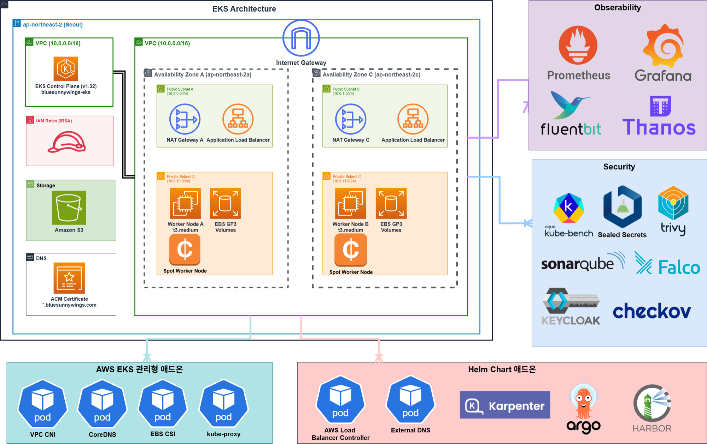
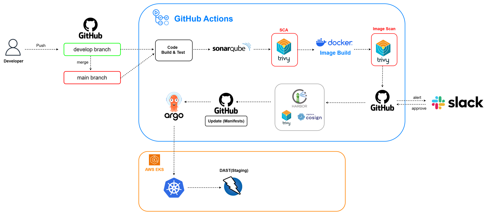
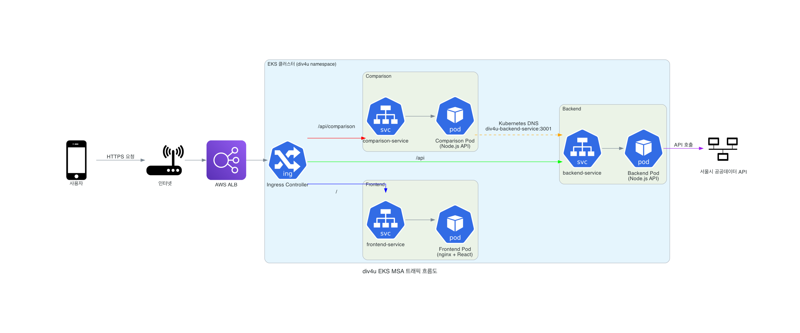

# div4u — 서울 실시간 혼잡도 서비스 + DevSecOps 운영 자동화

> CCCR CAB TA 4기 DevOps & SRE 과정 최종 프로젝트 (2025.07 ~ 2025.08, 4인) · **성과 보고회 우수상**

서울시 실시간 도시데이터 API로 장소별 혼잡도를 자연어로 조회하는 서비스를 EKS에 올리고, 그 위에 **IaC 검증 → 이미지 보안 스캔 → GitOps 배포 → CIS 점검 → 런타임 탐지**로 이어지는 DevSecOps 파이프라인을 구성한 프로젝트입니다.

## 아키텍처

### 인프라 (EKS + 보안·관측 도구)


- 서울 리전 VPC, 2개 AZ에 Public/Private 서브넷 구성. 워커 노드는 Karpenter Spot 노드 포함
- 관리형 애드온: VPC CNI, CoreDNS, EBS CSI, kube-proxy
- Helm 애드온: AWS Load Balancer Controller, External DNS, Karpenter, Argo CD, Harbor
- 보안: kube-bench, Sealed Secrets, Trivy, SonarQube, Falco, Keycloak, Checkov
- 관측: Prometheus, Grafana, Fluent Bit, Thanos

### CI/CD 파이프라인


`develop`/`main` push → 빌드·테스트 → SonarQube → Trivy SCA → 이미지 빌드 → Trivy 이미지 스캔 → **Slack 알림·수동 승인** → Harbor push(Cosign 서명) → 매니페스트 갱신 → Argo CD 배포 → Staging DAST

### 서비스 트래픽 흐름


| 서비스 | 스택 | 경로 |
|---|---|---|
| frontend | React 18 + Vite, nginx | `/` |
| backend | Node.js(Express, TypeScript), 서울시 API 연동·자연어 장소 매칭 | `/api` |
| comparison | Node.js(Express), 여러 장소 혼잡도 비교·캐시 | `/api/comparison` |

## 저장소 구성 (CCCR-div4u 조직)

| 저장소 | 내용 |
|---|---|
| **div4u** (이 저장소) | 애플리케이션 3종, Kustomize 매니페스트(`k8s/`), Argo CD Application(`argocd/`), CI/CD 워크플로 |
| [k8s-OSS](https://github.com/CCCR-div4u/k8s-OSS) | 클러스터 OSS 설치·설정(Argo CD, Harbor, Keycloak, Sealed Secrets, SonarQube, LGTM, Thanos), **Checkov·kube-bench 보안 점검 자동화** |
| [bluesunnywings-eks-tf-sunny](https://github.com/CCCR-div4u/bluesunnywings-eks-tf-sunny) | EKS·VPC·Karpenter Terraform, Terraform Checkov 워크플로 |
| [kyverno-kagent](https://github.com/CCCR-div4u/kyverno-kagent) · [kyverno-mcp](https://github.com/CCCR-div4u/kyverno-mcp) | Kagent·Kyverno 기반 정책·ChatOps 실험 |
| [k6](https://github.com/CCCR-div4u/k6) | 로컬 모니터링 환경 k6 부하 테스트 |

```
div4u/
├── frontend/      React UI
├── backend/       혼잡도 조회 API
├── comparison/    혼잡도 비교 API
├── k8s/           base + environments(staging, production)
├── argocd/        Argo CD Application
├── specs/         요구사항·설계·작업 문서
├── docs/          Harbor 보안, Git 브랜치 전략
└── scripts/       배포·시크릿·Harbor 설정 스크립트
```

## 보안 점검 자동화 (k8s-OSS · Terraform 저장소)

| 단계 | 구성 |
|---|---|
| PR · IaC | Helm 차트를 렌더링한 뒤 Checkov로 검사. 변경된 컴포넌트만 골라 스캔하고, 결과를 GitHub Issue·Slack으로 알림. Terraform 저장소에도 같은 Checkov 워크플로 적용 |
| 클러스터 CIS | kube-bench를 노드별 Job으로 실행 → 결과를 S3에 저장 → GitHub Issue·Slack 리포트 |
| 조치 보조 | Kagent 기반 `kagent-remediator`가 S3의 kube-bench 결과를 읽어 조치 방안 제시 |
| 런타임 | Falco 탐지 |
| 접근 제어 | Keycloak OIDC로 Argo CD·Harbor SSO |

## 실행

```bash
# 로컬 개발
cp .env.example .env               # 서울시 API 키 입력
cd backend && npm ci && npm run dev
cd frontend && npm ci && npm run dev

# 클러스터 배포 (Kustomize)
kubectl apply -k k8s/environments/staging
```

## 팀

4인 팀. 각 저장소의 담당자는 GitHub Contributors 탭에서 확인할 수 있습니다.
